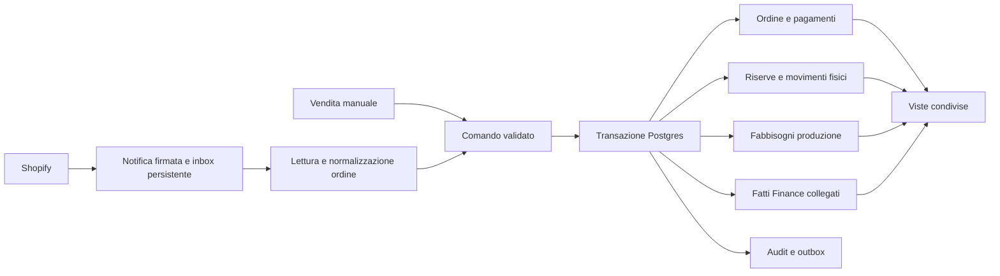

# Ecosistema LuckyLap: vendite, magazzino, produzione e Finance

Stato: contratto di dominio del 21 ottobre 2026. Il nucleo manuale e il ciclo produzione/consegna sono ora implementati e applicati al database; dettagli in `sales-ecosystem-backend.md` e `sales-interface.md`. Le parti Shopify, rimborsi e resi sono ancora previste. Nessuno storico vendite è stato importato e nessuna quantità Shopify è stata modificata. Tiene conto della richiesta aggiornata: una nuova vendita deve produrre effetti coerenti in tutte le sezioni.

## Fonti e significato dei numeri

| Dato | Autorità e comportamento |
| --- | --- |
| Capi fisicamente pronti per SKU e luogo | Apertura dallo snapshot Drive autorizzato; dopo l'avvio, registro movimenti del gestionale. Shopify non lo sovrascrive. |
| Quantità vendibile online | Shopify: disponibilità commerciale che può comprendere produzione su ordinazione. Non equivale a capi già pronti. |
| Ordini Shopify, pagamenti, rimborsi ed evasione | Shopify per i propri identificativi e fatti; il gestionale li riceve e li riconcilia senza registrare una seconda vendita. |
| Vendite dirette/Etsy non presenti su Shopify | Gestionale, con riferimento esterno quando esiste. Shopify POS rientra invece negli ordini Shopify. |
| Export BudgetFlow | Fonte storica Finance non revisionata. Non è un secondo registro delle vendite né una misura automatica dei ricavi. |
| Costi COGS e PDF recap | Fonti storiche separate, da revisionare; non sovrascrivono costi o saldi attuali. |

Lo snapshot importabile contiene 214 capi: è il valore salvato nel file, non una conta certificata al momento dell'attivazione. La data di modifica del file non dimostra la data fisica della conta. Prima di applicare automaticamente movimenti nuovi occorre una data di avvio concordata e una verifica delle operazioni già comprese nell'apertura. Nessuna riproduzione automatica degli ordini passati contro queste quantità.

## Un unico fatto, più viste

L'interfaccia invia un comando al server; una funzione database autorizzata salva tutti gli effetti locali in una transazione. Magazzino, Vendite, Produzione e Finance leggono gli stessi fatti. Non concatenare quattro richieste indipendenti dal browser, non usare Realtime o il calendario come motore contabile, non creare una vendita a ogni notifica Shopify.

La sincronizzazione esterna non può essere atomica con il database locale. Il confine transazionale è Postgres; inbox/outbox e retry rendono recuperabile ciò che attraversa il confine. Nessuna chiamata HTTP Shopify dentro una transazione che mantiene lock sui saldi. È coerente con l'uso delle [Database Functions Supabase](https://supabase.com/docs/guides/database/functions) per operazioni sui dati.

## Stock pronto, riservato e da produrre

Per ciascuna coppia SKU/location esistono tre quantità distinte: `on_hand` fisico, `reserved` su capi fisici e `available = on_hand - reserved`. Una quantità ignota rimane ignota e blocca l'allocazione automatica. Le riserve non aumentano il fisico e il fabbisogno produzione non rende disponibili capi inesistenti.

Per un ordine confermato di Q unità, bloccare saldo e riserve dello SKU/location, assegnare al massimo il disponibile fisico e aprire un fabbisogno per il residuo. Esempio sintetico: 2 capi pronti, ordine di 3 → fisico 2, riservato 2, disponibile 0, da produrre 1. Completata e verificata la produzione: movimento +1 e riserva di quell'unità. Alla consegna delle 3: movimento −3 e chiusura delle riserve. Il pagamento non causa un secondo scarico.

La vendita immediata con consegna contestuale esegue conferma, pagamento dichiarato e scarico nella stessa transazione: l'utente vede subito diminuire lo stock. Un ordine da spedire diminuisce subito il disponibile, mentre il fisico scende quando la merce esce. Una riga può essere evasa o prodotta parzialmente.

Il fabbisogno automatico va in `da_pianificare`; l'avvio effettivo della produzione richiede conferma di Gabriele. «Circa due giorni» è una stima operativa fornita dal founder, non un completamento automatico né una promessa di consegna. Non inventare calendario lavorativo, capacità produttiva, materie prime, costi o distinte base.

## Modello minimo da aggiungere

I nomi seguenti sono contratti di dominio, non DDL già applicata.

| Entità | Chiavi e responsabilità |
| --- | --- |
| `channel_connections` | Negozio Shopify e stato collegamento; segreti solo lato server, fuori dalle tabelle leggibili dai membri. |
| `external_variant_mappings` | Coppia shop + GID variante Shopify → `stock_item_id`; mapping verificato, SKU della fonte conservato. SKU assente/ambiguo va in revisione, mai abbinato per titolo approssimativo. |
| `sales_orders`, `sales_order_lines` | ID interno; sorgente/ID esterno unici; canale distinto dal mezzo di pagamento; prezzi, sconti e valuta fotografati al momento della vendita; revisione e quantità annullate/evase per riga. |
| `order_payments`, `payment_refunds` | ID transazione esterno univoco per shop o UUID operazione manuale; tipo, stato, importo, valuta, data, riferimento all'ordine e transazione originaria. |
| `stock_reservations` | Quantità attiva per riga ordine, SKU e location; eventi di assegnazione/rilascio append-only e proiezione corrente. |
| `fulfillment_lines` | ID evasione + riga esterna e quantità; collegamento ai movimenti fisici già applicati. Non scaricare nuovamente al cambio del tracking. |
| `production_requirements`, `production_receipts` | Fabbisogno collegato a riga ordine; quantità pianificate/pronte/annullate, responsabile e stima; ricevimento effettivo identificato e idempotente. |
| `commercial_facts`, `settlement_allocations` | Fatti economici operativi e legami di riconciliazione a incassi, rimborsi, commissioni e fonti BudgetFlow. Non costituiscono automaticamente contabilità fiscale. |
| `integration_inbox`, `integration_jobs`, `integration_outbox` | Notifiche persistenti, tentativi e stato elaborazione; job per ordine e versione; outbox per effetti esterni futuri. Payload e errori riservati. |

Estendere il registro `stock_movements` con causali specifiche per consegna, produzione, reso e trasferimento. Conservare apertura/rettifica già presenti; non rappresentare ogni vendita come una rettifica generica e non cambiare il significato di movimenti già salvati. I trasferimenti centrale ↔ negozio richiedono due gambe collegate nella stessa transazione, a totale rete invariato.

L'attuale `finance_entries` è un contenitore manuale income/expense, non un libro mastro sufficiente per ordini, crediti verso gateway, quote negozio e riconciliazioni. Non alimentarlo con insert automatici indipendenti e cancellabili. Prima definire fatti append-only con riferimento causale e una vista riepilogativa; la classificazione contabile sarà un passaggio esplicito di Finance.

## Contratto dei comandi

Ogni comando logico riceve un `operation_id` UUID stabile tra i retry, versione schema, autore/sessione e hash del payload normalizzato. Il server determina appartenenza e permessi; non si fida di ruoli, totali o costo dichiarati dal browser. Tutti i cinque membri attivi possono registrare operazioni e sconti secondo la regola approvata; la causale è obbligatoria per rettifiche e modifiche economiche.

Per il primo flusso, la RPC pubblica proposta è `register_manual_sale(p_operation_id uuid, p_payload jsonb)`. È un solo comando aggregato, con i seguenti campi ammessi:

| Campo payload | Validazione e significato |
| --- | --- |
| `schema_version` | Intero 1; chiavi sconosciute rifiutate. |
| `channel` | `direct`, `etsy` o `manual_other`; non `shopify` o `shopify_pos`, che devono avere origine esterna verificata. `cash` è un metodo di pagamento, non un canale. Conto vendita rinviato finché manca la base del riparto. |
| `external_reference` | Facoltativo per direct, obbligatorio per Etsy/manual_other quando la fonte fornisce un ID; unicità fonte+ID per evitare reinserimenti. |
| `occurred_at` | Timestamp con offset valido, non futuro; conservare istante e data operativa Europe/Rome. Il flusso nuovo non è un import storico. |
| `location_id` | Location attiva di prelievo/riserve; nessuna scelta automatica del magazzino negozio. |
| `lines` | Array non vuoto, limite iniziale 50; righe con SKU distinti, `stock_item_id` prodotto attivo, `quantity` intero positivo entro limite, `unit_price_cents` intero non negativo, `discount_cents` intero fra zero e prezzo unitario × quantità. Lo sconto è totale di riga in questo contratto, non ambiguamente unitario. |
| `fulfillment_mode` | `delivered_now` oppure `prepare`; il primo rifiuta stock pronto insufficiente o ignoto senza produrre dati parziali. |
| `payment` | `status` = `paid`/`unpaid` nel primo flusso. Se paid: metodo esplicito (`cash`, `bank_transfer`, `external_card`, `other`), importo esatto uguale al dovuto, timestamp e riferimento se disponibile. Se unpaid: nessun incasso creato. Niente carta memorizzata o addebito eseguito dall'app. Pagamento parziale previsto dal modello ma fuori da questa prima RPC. |
| `reason` | Motivazione richiesta quando prezzo/sconto differiscono dal listino corrente; tutti i membri possono farlo, senza soglie o approvazioni non concordate. |

Il server calcola totale da righe validate, non accetta `total` dal client; fotografa listino e costo attuali dal DB, mantenendo costo sconosciuto come NULL. Confronta prezzo dichiarato/listino per richiedere la motivazione, non per impedire gli sconti autorizzati. Importi con centesimi interi e valuta EUR fissa per la prima RPC; nessun calcolo IVA implicito. L'interfaccia non chiama la RPC per ogni riga.

Risposta minima: `order_id`, `operation_id`, `replayed`, `total_cents`, `payment_state`, `fulfillment_state`, riepilogo per riga di `reserved_quantity`, `production_required_quantity`, `on_hand_after`, `available_after`, e ID del fatto Finance. La risposta non include saldi conti, descrizioni BudgetFlow o dati riservati. Gli errori macchina distinguono `membership_required`, `idempotency_conflict`, `invalid_payload`, `duplicate_external_reference`, `unknown_stock`, `insufficient_ready_stock`, `inactive_item`; messaggi pubblici senza dump SQL o payload Finance.

`sales_orders` conserva operation ID/hash/esito. Ogni riga ha un ID interno stabile. Se un ordine produce più movimenti, il loro `operation_id` non può essere quello comune dell'ordine perché il registro attuale lo rende unico: generare identificativi di effetto distinti, salvarli e vincolarli a riga+tipo+revisione. Ripetere l'ordine ritorna gli effetti già esistenti. Il wrapper pubblico invoker può delegare a processore privato strettamente controllato per applicare effetti Finance senza concedere accesso libero a quelle tabelle; revocare EXECUTE pubblico implicito e ricontrollare membership nel processore privilegiato.

| Comando | Effetti locali atomici |
| --- | --- |
| `confirm_order` | Congela revisione e importi, registra fatto commerciale operativo, riserva il pronto, apre fabbisogni e audit. |
| `record_payment` | Aggiunge solo il pagamento verificato/dichiarato e la relativa proiezione Finance; nessun nuovo ordine o scarico. |
| `record_production_receipt` | Aggiunge capi fisici realmente pronti e li assegna al fabbisogno; non registra una spesa né un acquisto pagato. |
| `fulfill_order_lines` | Verifica capi/riserve/location, registra uscita, chiude riserve e aggiorna quantità evase. |
| `cancel_unfulfilled_lines` | Annulla residuo, libera riserve, riduce fabbisogni non avviati; produzione avviata va in eccezione. Nessun rimborso inventato. |
| `record_refund` | Collega rimborso riuscito al pagamento originario; non presume ricezione fisica del reso. |
| `receive_return` | Registra controllo e luogo del capo restituito: vendibile o quarantena/difettoso. Aumenta il disponibile solo se vendibile. |

Un ordine può essere contemporaneamente pagato parzialmente, evaso parzialmente e rimborsato parzialmente. Usare stati separati per ciclo ordine, pagamento, evasione e produzione; evitare un unico campo `status` che li confonda. Il costo storico fotografato è distinto dal costo futuro di produzione ancora ignoto.

## Transazioni, idempotenza e concorrenza

1. Verificare sessione e membership DB attuale; il processore Shopify ha un'identità tecnica ammessa solo ai comandi di integrazione, senza impersonare un dipendente.
2. Acquisire lock per operation ID e ordine; confrontare l'hash. Stessa chiave e stesso payload restituiscono l'esito già salvato; stessa chiave con payload diverso è conflitto.
3. Bloccare in ordine deterministico SKU/location e riserve prima dell'allocazione. Verificare `reserved <= on_hand`, quantità non negative, valuta/importi e riferimenti.
4. Salvare ordine/revisione, pagamenti, riserve, fabbisogni, movimenti, fatti Finance, audit e outbox nella stessa transazione. Un errore annulla tutto.
5. Pubblicare l'esito solo dopo commit. Gli aggiornamenti dell'interfaccia si ricaricano dalla proiezione risultante; Realtime serve a segnalare cambiamenti, non a registrare effetti.

Le chiavi uniche dei fatti economici e logistici restano necessarie oltre alla deduplicazione HTTP: ordine per `(shop, external_order_id)`, pagamento per `(shop, external_transaction_id)`, evasione per `(shop, external_fulfillment_id, external_line_id, revisione_effetto)`, rimborso per ID e componente. Il processore applica soltanto effetti nuovi o compensazioni esplicite; non riapplica l'intero totale corrente a ogni aggiornamento. Nessun UPDATE/DELETE dei fatti approvati: correzioni tramite storni collegati. I lock e gli invarianti vanno provati su più connessioni PostgreSQL reali.

Le notifiche possono arrivare duplicate, in ritardo e fuori ordine: una cancellazione già nota non deve essere annullata da un vecchio `orders/create`. Conservare versione sorgente, timestamp, digest e identificativi dei fatti; rileggere lo stato canonico se serve. Una revisione vecchia non sovrascrive quella nuova; stesso timestamp con contenuto incompatibile va in revisione, non viene risolto con l'ordine di arrivo. Shopify documenta sia l'assenza di ordine garantito sia la necessità di [riconciliazioni periodiche](https://shopify.dev/docs/apps/build/webhooks).

## Shopify: primo collegamento in lettura

Al 21 ottobre 2026 la documentazione Admin indica **2026-10** come latest. Per il primo connettore scegliere webhooks HTTPS + Admin GraphQL 2026-10, fissando la versione quando si implementa. Events è una nuova alternativa compatibile e può convivere con i webhooks; non abilitarli entrambi per gli stessi effetti durante il primo rilascio. [Admin Order](https://shopify.dev/docs/api/admin-graphql/2026-10/objects/Order), [Events](https://shopify.dev/docs/api/events/2026-10).

Il collegamento dell'assistente a Shopify non è automaticamente una credenziale permanente per il gestionale. Occorrono un'app installata sul negozio e credenziali server valide per lettura ordini e verifica firma. Non chiedere token in chat; non copiarli in Git, variabili `NEXT_PUBLIC_`, log o browser. Usare scope minimi: `read_orders`, `read_products` per mapping catalogo e `read_fulfillments` se si sottoscrivono le notifiche fulfillment. Nessun `write_inventory` né modifica disponibilità, prezzi o ordini Shopify in questa fase.

Sottoscrizioni candidate: `orders/create`, `orders/updated`, `orders/edited`, `orders/cancelled`, `orders/paid`, `order_transactions/create`, `fulfillments/create`, `fulfillments/update`, `refunds/create`, più revoca/disinstallazione. Gli stati pagamento aggregati sono informativi; importi e stati delle singole transazioni determinano incassi e rimborsi. `sourceName` e il riferimento esterno distinguono Shopify web e POS: un pagamento POS in contanti non è una seconda vendita manuale. Verificare gli scope dei topic nel [riferimento ufficiale](https://shopify.dev/docs/api/admin-graphql/2026-10/enums/WebhookSubscriptionTopic) all'implementazione.

Il receiver verifica shop ammesso e HMAC sul **corpo raw**, salva inbox + lavoro persistente prima del 2xx e risponde rapidamente; se non può persistere, restituisce errore recuperabile. `X-Shopify-Webhook-Id` deduplica la consegna; `X-Shopify-Event-Id` correla notifiche della stessa azione, non identifica da solo ogni effetto di dominio. Non usare lo stesso set di header senza modifiche per Events. [Verifica consegne Shopify](https://shopify.dev/docs/apps/build/webhooks/verify-deliveries).

Il worker legge solo i campi necessari di ordine, righe, prezzi/sconti, transazioni, rimborsi ed evasione; paginazione completa, importi decimali esatti, nessun dato personale cliente non necessario. Le letture canoniche avvengono fuori dai lock; il commit confronta la versione e ritenta in caso di conflitto. Un job per ordine resta aperto finché tutti gli effetti necessari sono salvati. Retries con backoff, limite tentativi, errore visibile e riavvio manuale; mai fingere successo di un ordine con SKU sconosciuto.

Per non perdere eventi in caso di pausa del piano Free o errore del receiver, aggiungere riconciliazione Admin `updated_at` con finestra sovrapposta e cursore persistente, processata dallo stesso normalizzatore. Il polling di recupero non importa automaticamente lo storico pre-avvio. Gli ordini più vecchi di 60 giorni richiedono permesso aggiuntivo; non richiederlo per semplice comodità. [Limite accesso ordini](https://shopify.dev/docs/api/admin-graphql/2026-10/objects/Order).

L'inbox persistente basta per il primo volume: nessun broker a pagamento. Un worker ricorrente autenticato deve però essere effettivamente attivato e monitorato; il lavoro non può dipendere da una scheda browser aperta o da una promessa `waitUntil` non durevole. Se serve, [Supabase Queues](https://supabase.com/docs/guides/queues) offre una coda Postgres; il rilascio richiede comunque deduplicazione degli effetti e verifica dei limiti del progetto.

## Finance senza doppio conteggio

Ordine, incasso cliente e accredito su conto sono fatti diversi. La vista Vendite mostra valore venduto e dovuto; la vista incassi mostra transazioni riuscite meno rimborsi; la cassa/banca mostra movimenti effettivi riconciliati. Una sola metrica non deve sommare tutte e tre. Una autorizzazione carta, un tentativo fallito o `pending` non sono un pagamento riuscito.

Esempio sintetico: cliente paga 40 EUR online, gateway accredita successivamente 38 EUR. Esistono una vendita di 40, un pagamento di 40, un regolamento di 38 e una differenza da verificare. Non sono 118 EUR di ricavi; i 2 EUR non diventano automaticamente commissioni senza fonte verificata. Il saldo di apertura dei conti e della cassa resta sconosciuto finché Finance lo fornisce.

BudgetFlow mantiene `finance_import_batches` e `finance_import_transactions` immutati e `unreviewed`. Non convertirli in vendite o nuovi pagamenti sulla base di categoria, descrizione o segno. Per gli export sovrapposti resta il blocco già previsto dal generatore. Una futura revisione può collegare una o più righe sorgente a pagamenti/regolamenti già esistenti, con importi allocati, autore e data; i match automatici sono soltanto proposte. Identificativi gateway/ordine verificati prevalgono su similarità di importo/data. Un trasferimento fra conti non è nuovo ricavo o costo.

Le celle/righe aggregate del PDF e del COGS tracker non si aggiungono ai totali BudgetFlow. Prezzi, sconti e costo fonte sono visibili a tutti nel dominio operativo; conti, note Finance e riconciliazioni restano riservati a founder, Gabriele e Gherardo con MFA, secondo il modello già predisposto. Una vendita autorizzata può creare tramite il processore un fatto Finance protetto senza concedere al venditore SELECT o INSERT libero su tutta Finance.

## Conto vendita e packaging

Il trasferimento di capi al negozio sposta stock fra location e non genera ricavi. Il sell-through dichiarato dal negozio scarica la sua location, registra la vendita al cliente e la posizione da regolare con il partner; l'incasso successivo chiude quella posizione senza creare una seconda vendita. Prezzo proposto: sito + 10 EUR, quota brand 60%, negozio 40%, fotografati nella vendita. IVA, base della ripartizione dopo sconti e modalità di fatturazione restano da definire: fino ad allora niente riparti contabili automatici.

Scatole e adesivi delle scatole sono stock packaging distinto dagli sticker retail Shopify. Non scaricarli automaticamente per maglietta finché non sono confermati quantità iniziali e regola di confezionamento: più capi possono usare una scatola. Il consumo futuro avviene sul confezionamento/consegna e con operazione propria, non sull'arrivo del pagamento.

## Primo flusso implementabile e attivazione

1. Concludere progetto Free, auth, RLS e import delle sole fonti già autorizzate. Inventario con provenienza e Finance storico non revisionato; nessun ordine storico.
2. Aggiungere migrazione dedicata per ordini, righe, pagamenti, riserve, fabbisogni, fatti e RPC. Primo percorso: vendita manuale diretta in EUR di SKU conosciuti, location esplicita, sconto visibile, indicazione «consegnata ora» o «da preparare», pagamento e metodo espliciti. Se manca stock, solo il percorso da preparare apre il fabbisogno. Nessun saldo cassa di apertura o IVA inventati.
3. Verificare in ambiente di prova: retry identico, retry alterato, due vendite concorrenti sull'ultimo capo, pagamento e consegna separati, produzione parziale, annullo, rimborso senza reso, reso non vendibile, permessi Finance e audit. La vista Finance deve mostrare il riferimento alla stessa vendita.
4. Attivare app Shopify in sola lettura e modalità osservazione: notifiche, mapping e differenze visibili senza effetti sulle scorte. Provare replay duplicato/fuori ordine, recovery dopo timeout e evento con SKU non mappato.
5. Concordare cutover: data/ora Europe/Rome, conferma stock pronto, elenco ordini aperti e ciò che è già incluso. Attivare effetti futuri e verificare un ordine reale scelto, senza acquistare servizi. Nessuna disattivazione del controllo RLS e nessuna correzione automatica delle quantità commerciali Shopify.

La regola adottata per il primo percorso è riserva su conferma ordine, fabbisogno immediato per il mancante e avvio produzione confermato da una persona. Prima dell'attivazione reale restano due decisioni operative: quando considerare l'apertura aggiornata e quali ordini aperti include; base IVA/sconti del 60/40, necessaria soltanto per automatizzare il conto vendita. Non impediscono import, collegamento in osservazione o sviluppo delle vendite dirette. La data di avvio impedisce doppi scarichi al passaggio dal vecchio sistema.

## Verifica della ricerca

Analizzati schema attuale (`opening`/`adjustment`, saldi protetti, membership DB, audit, import Finance append-only), lettura Finance e documenti di auth/import. Consultati skill Supabase e Shopify Admin con strumentazione Shopify disattivata. Changelog Supabase letto fino al 21 ottobre 2026: la dismissione di vecchi cipher TLS a novembre e la patch Postgres di settembre non cambiano questo contratto; nessuna nuova API Supabase è stata implementata qui. Non generati GraphQL, SQL o codice applicativo: i contratti andranno validati contro schema e versione fissata nella fase di implementazione.
